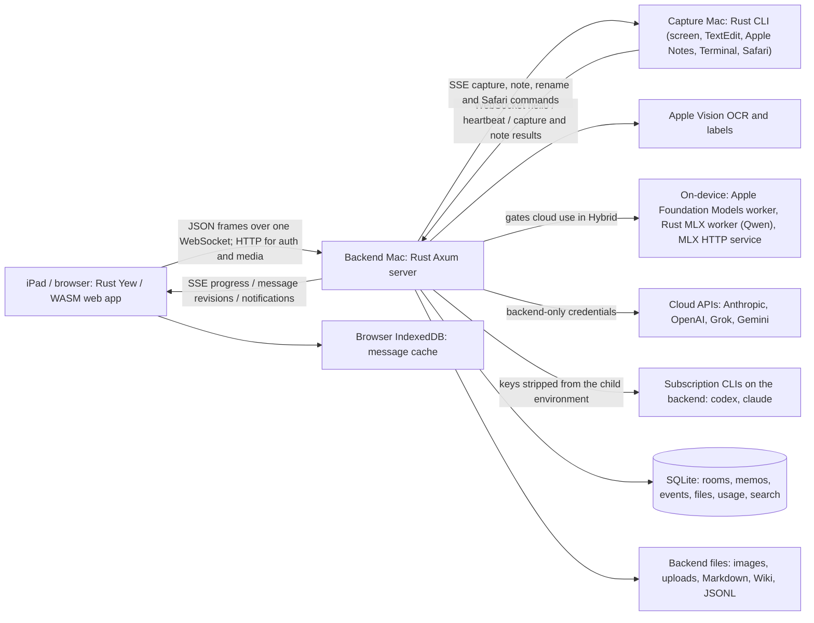

# Invisible AI — work plan and implementation notes

Updated: 2026-10-08. The crates and repository keep the `causewaybay` prefix; the product is Invisible AI.

## Goal

A Rust workspace that lets a user capture a remote computer, ask a cloud AI about the screen or an uploaded file, and keep the conversation and results. The intended deployment is inside the user's VPN:

- **Mac Studio:** Rust backend, Apple Vision OCR, cloud AI calls, SQLite, and file storage. Listen on `0.0.0.0:3000`.
- **MacBook:** Rust capture CLI. Maintain a WebSocket connection, receive capture commands over SSE, and reconnect after a delay.
- **iPad:** Rust/Yew/WASM web app with locally compiled Tailwind CSS. JSON requests over HTTP/WebSocket; streamed callbacks and replay over SSE.

Implementation conventions:

- A bounded coding-agent tool loop and wallet challenge authentication.
- Standard BIP-39/BIP-32 mnemonic-derived Ethereum identity.
- Browser-local signing and IndexedDB storage.

## Current status and architecture

The implemented scope is complete and locally verified: 39 native Rust tests, strict native/WASM checks, real OCR, and all 38 Playwright tests including live Grok and native screen capture. The remaining items below are explicitly deferred features and device/provider validation outside this local run. Detailed wire formats are in [PROTOCOL.md](PROTOCOL.md); recorded test evidence is in [docs/verification.md](docs/verification.md).



| Component | Implementation | Responsibility |
| --- | --- | --- |
| `crates/server` | Rust, Axum, Tokio, rusqlite | Serve UI/API, authorize users, orchestrate capture/AI, run the tool loop, persist and search |
| `crates/cli` | Rust, clap, native macOS screenshot command, AppleScript automation | Stable capture-node identity, owner, callbacks, capture results, TextEdit/Apple Notes/Terminal reads and appends, retry |
| `crates/frontend` | Rust, Yew, WASM | Login, New thought and chat rooms, Autonomous AI (`/autonomous`), Wiki, library, Files/Images/Videos, Dashboard (`/dashboard`), Devices (`/devices`), assistance and admin settings |
| `native/apple-ai` | Swift, FoundationModels, Speech | Stdin/stdout worker for on-device generation and transcription, spawned by the backend |
| `crates/shared` | Rust serde models, identity, configuration helpers | JSON contracts, BIP-39/EIP-191, quizzes and native JSONL snapshots |
| Build and verification | Makefile, Trunk, Tailwind, Playwright | Local assets, native/WASM builds, packaging, Rust and browser tests |

The frontend's application logic is Rust; Tailwind/build tooling and Playwright tests use Node. The browser does not call AI providers directly. A MacBook capture never happens on the iPad or implicitly on the backend: the request is routed to the selected connected capture node.

Most browser API calls travel as JSON request frames over the single `/api/ws` WebSocket; the server re-enters its Axum router for each frame, so authorization and wallet scoping have one code path. The database is one SQLite connection behind a mutex and chat submissions take a global lock, which is right for one household and a ceiling for anything larger. The provider layer is one request builder and one streaming accumulator covering Anthropic, Gemini and the OpenAI-shaped APIs; local workers and the Codex and Claude Code CLIs are text-only providers without backend tools.

## End-to-end flows

### Start and connect

1. `make start` builds the web assets/backend and starts only the backend. `make start2` starts the backend plus a local capture CLI; `make start3 BACKEND_URL=URL` starts only the CLI. For wallet-owned capture on a separate computer, use `rust_cli URL [OWNER_WALLET_ADDRESS]`.
2. The backend loads environment/`.env`, JSONL defaults, users and node aliases, opens/migrates SQLite and files, resets stale presence, and listens on `0.0.0.0:3000`.
3. Startup prints actual localhost/LAN/VPN web and API addresses, health, devices and local Tailwind asset links.
4. Capture CLI registers on WebSocket and opens its connection-bound SSE callback stream. The web user signs in; once approved, the tab opens its own WebSocket and event streams.
5. Devices shows both kinds of connected clients. Each disconnected transport sleeps before retrying; stale sessions cannot leave an old connection marked online.

### Login and approval

1. Derive a public Ethereum address from the mnemonic locally in Rust/WASM.
2. Obtain and sign a one-use, host-bound server challenge; send only its nonce and signature.
3. Receive a cookie session. Unregistered users see Apply; pending users see Waiting.
4. The owner/admin approves the applicant from Admin. The applicant becomes a workspace user without signing in again.
5. An admin can later promote an approved user or block access. Live API/WS/SSE checks use the current role. The environment owner remains permanent.

### Capture and answer

```mermaid
sequenceDiagram
    participant W as Web client
    participant B as Backend
    participant C as Capture CLI
    participant A as Cloud AI
    W->>B: JSON Think request (node, mode, room/message IDs)
    B->>B: Check approval/ownership, save job/messages
    B-->>W: Memo accepted
    B-->>C: SSE capture command (request GUID)
    C->>C: Native capture; save PNG
    C->>B: WebSocket capture_result (base64 image)
    B->>B: Save original image and relative path
    B-->>C: capture_ack
    B-->>W: SSE image ready; authenticated preview URL
    alt Text mode
        B->>B: Apple Vision OCR; save exact text
        B-->>W: SSE OCR text
        B->>A: Extracted text + question/context
    else Image mode
        B->>A: Image + question/context
    end
    A-->>B: Answer/tool-call stream
    B->>B: Save deltas, message revisions, Markdown
    B-->>W: SSE progress, answer, final status
    W->>W: Save message JSON to IndexedDB
```

For uploaded files, the web client first sends base64 JSON to `/api/files`, then submits Think with `file_id`. The backend processes image/audio/text/CSV/raw content as applicable before asking AI. For a plain question it skips capture/media processing. Comments become response suggestions; coding questions become code; other questions get direct answers.

### Chat, continuous capture and reconnect

Create/select a room GUID, submit a new message GUID, and apply server-assigned int64 revisions. `messagesyncid` is a replay cursor; `sequence` determines display order. The backend saves canonical messages plus a durable revision log. The browser loads its wallet-scoped IndexedDB cache and catches up using HTTP sync/SSE. An identical message retry returns its existing memo; changed content with a reused GUID fails.

Continuous capture snapshots selected/all permitted nodes, generates a new message for each capture, waits for the round's answers, then sleeps for the chosen interval. Stop cancels pending work and prevents further rounds. Loop generation IDs protect rapid stop/start, and permissions are checked before each new frame. A backend restart stops active loops; durable conversations remain.

## HTTP, WebSocket and SSE overview

All application messages use JSON. HTTP serves the UI, authentication, ordinary API routes and raw file/image downloads. WebSocket keeps web/CLI connections alive; SSE delivers backend callbacks with reconnect support.

| Transport | Endpoint | Contract |
| --- | --- | --- |
| HTTP | `/api/auth/*` | Challenge, signature verification, session state, apply/logout |
| HTTP or browser WS | `/api/settings`, `/api/admin/users*` | Defaults and approval/admin controls; mutations require admin |
| HTTP or browser WS | `/api/think`, `/api/capture/batch` | Start one question/capture or selected/all node captures |
| HTTP or browser WS | `/api/rooms`, `/api/rooms/{id}/sync`, `/api/rooms/{id}/capture` | Room creation/list, revision replay and continuous start/status/stop |
| HTTP or browser WS | `/api/memos*`, `/api/files*`, `/api/images`, `/api/ai*` | Search/save, media/tool operations and provider status |
| HTTP or browser WS | `/api/clients*`, `/api/devices` (alias `/api/dashboard`), `/api/status` | Presence, caller-specific capture permission, admin rename, workspace statistics |
| HTTP or browser WS | `/api/invisible/sessions*` | Autonomous AI sessions (the API keeps its older name), approvals and remote prompts |
| WebSocket | `/api/ws` | Browser hello/ready, heartbeat, request/response correlation |
| WebSocket | `/api/client/ws` | CLI hello/ready, heartbeat, capture_result/capture_ack |
| SSE | `/api/memos/{id}/events` | `{id,kind,text}` events; durable answer delta replay |
| SSE | `/api/rooms/{id}/events` | Complete ChatMessage revisions with int64 SSE IDs |
| SSE | `/api/client/events?client_id=...` | Capture and rename commands, authenticated by current WS session |
| HTTP bytes | `/api/memos/{id}/image`, `/export`, `/api/files/{id}/download` | Authenticated original image, Markdown or file bytes |

Browser WebSocket example:

```json
{"type":"hello","id":"web-tab-id","name":"iPad","platform":"iPad"}
{"type":"ready","client_id":"web-tab-id"}
{"type":"request","id":1,"method":"POST","path":"/api/think","body":{"capture":true,"client_id":"macbook-id","input_mode":"text","prompt":"Explain this screen"}}
```

The reply is `{"type":"response","id":1,"status":200,"data":<full Memo JSON>}`. It starts work; final completion arrives through SSE. Raw media, authentication and SSE use HTTP directly, not nested WebSocket requests. A browser request never contains a provider API key.

CLI hello includes `owner_wallet` and `callbacks:"sse"`. Ready returns a connection secret; the CLI sends it as `x-capture-session` when opening its SSE stream. A callback contains `type:"capture",request_id,mode,display`. The CLI responds through WebSocket with `type:"capture_result",request_id,image_base64` or an error; the backend acknowledges acceptance.

Browser retry delay is two seconds; CLI WS retry defaults to three seconds, bounded 1–60; SSE advertises a two-second retry. CLI heartbeats run every 10 seconds; server sockets expire after 35 seconds without traffic, and initial hello has a 10-second timeout. SSE uses 10-second keepalives and `Last-Event-ID` replay where applicable. Uploads are bounded to 25 MiB decoded, with 36 MiB JSON/WS limits. See [PROTOCOL.md](PROTOCOL.md) for complete schemas, authentication, errors, route lists and retry/idempotency rules.

## Delivery milestones and progress

| Phase | Status | Delivered |
| --- | --- | --- |
| Foundation | Done | Four Rust crates, clap commands, Axum server, Yew UI, local Tailwind and generated artwork |
| Persistence/search | Done | SQLite/FTS5/semantic fusion, JSONL snapshots, backend/client folder separation |
| Capture/AI | Done | Remote capture dispatch, Apple Vision, four provider adapters, backend-only keys, streamed results |
| Capture repair | Done | Visible UUID PNG names and output-file checks fix macOS hidden-file/no-such-file failure |
| Connectivity | Done | JSON HTTP/WS, SSE callbacks/replay, heartbeat/retry, dashboard, stable IDs, stale-presence protection |
| Node management | Done | Automatic computer name, rename persistence, subset/all capture, owner/shared modes |
| Coding/files | Done | Bounded tools, versioned writes, Rust compilation, upload/download/process/delete |
| Coding projects | Done | Per-project folders in six languages, sandboxed build and run, model harness and Codex/Claude Code modes, skills the chat can run |
| Chat/media | Done | GUID rooms/messages, int64 revisions, IndexedDB cache, repeated screenshots, OCR/image/audio display |
| Identity/access | Done | Mnemonic signing, owner env, applications, approval, delegated admins, revocation enforcement |
| Verification | Done | Native/WASM checks, Rust, real OCR/embedding, 38 integrated Playwright checks, package smoke test |
| Handoff | Done | Architecture/flow/progress in PLAN, HTTP/WS/SSE reference in PROTOCOL, verification record, package docs |

## Identity and permissions

- [x] Read the permanent owner wallet from backend `CWBBOT_ADMIN`, including `.env`. Configure your own owner address locally; public examples use `0xYOUR_OWNER_WALLET_ADDRESS`.
- [x] Sign in using a BIP-39 mnemonic, deriving Ethereum account 0 at `m/44'/60'/0'/0/0`.
- [x] Derive and sign in browser memory. Never send or persist the mnemonic/private key. No blockchain transaction is needed.
- [x] Verify a host-bound EIP-191 challenge on the server. Challenges expire after 120 seconds and can be used once.
- [x] Store only hashes of opaque session tokens in SQLite. Browser sessions use HttpOnly, SameSite cookies, with Secure on HTTPS.
- [x] Let an unapproved wallet sign in, but expose only registration/session/logout functions.
- [x] Let the wallet apply with a display name, then show a waiting screen that updates after approval.
- [x] Show pending applications in **Admin → Waiting for approval**.
- [x] Allow admins to approve, decline/block, promote approved users to admin, and demote designated admins.
- [x] Keep the environment owner permanent: the web API cannot demote or block `CWBBOT_ADMIN`.
- [x] Show Admin, backend settings, and node-renaming actions only to admins. Enforce the same rules on HTTP and WebSocket APIs.
- [x] Recheck session and approval while streaming callbacks and when handling new requests.
- [x] Persist the user list and actor/action/target audit snapshots to `users.jsonl`, mirrored into SQLite for live checks.

Role flow: `unregistered → pending → user → admin`. Admins may change an approved user to `blocked`; blocked users cannot reapply until an admin approves them again.

**Deployment note:** set `CWBBOT_ADMIN` to activate approval-controlled wallet access. When it is unset, the earlier local/demo or access-token mode remains available. Content is now scoped to the authenticated wallet, including rooms, memos, files, saved captures and search. Admin roles do not bypass content ownership. Capture hardware can be explicitly shared; resulting data remains private to the requester. Legacy unowned content remains in the local account.

## Capture-node ownership

- [x] Support `rust_cli URL OWNER_WALLET_ADDRESS` and the `rust-cli` alias.
- [x] Permit only the matching approved wallet to capture from an owned node. Admins have no ownership bypass.
- [x] Support `rust_cli URL` for a shared node usable by any approved workspace user.
- [x] Persist ownership, stable node ID, backend URL, computer name, and retry interval in client JSONL.
- [x] Restore the saved URL, ownership and node identity when launched without arguments; show help if no connection has been saved.
- [x] Apply ownership checks to single capture, selected-node batches, capture-all, and continuous capture.
- [x] Discover the computer name automatically and allow admins to rename it from Devices.
- [x] Show connection state for Rust nodes and web clients; retry disconnected transports after sleeping.

The positional URL without an owner explicitly chooses shared access. Advanced commands offer `client --owner-wallet ADDRESS` and `client --shared`; omitting both in the advanced command restores saved ownership.

`APP_TOKEN` is an optional capture-node connection credential. In wallet mode it cannot grant browser or admin access. If omitted, capture-node transports accept connections within the trusted VPN; workspace data still requires an approved wallet.

## Capture, chat, and AI

- [x] **Text mode:** capture → save original image → Apple Vision OCR on backend → cloud AI. Show the image and extracted text in chat.
- [x] **Image mode:** capture → save original image → send a bounded image copy to cloud vision. Show the image in chat.
- [x] Reply suggestions for comments, complete code for coding questions, and direct answers to other questions.
- [x] Support Anthropic, OpenAI, Grok/xAI, and Gemini credentials on the backend only.
- [x] Expose the selected provider/model in Chat; let admins explicitly check the connection through a backend inference call.
- [x] Use GUIDs for `roomid` and `messageid`. Use server-assigned int64 `messagesyncid` for replay, plus immutable `sequence` for display order.
- [x] Treat repeat submissions with the same message GUID idempotently; reject different requests that reuse that GUID.
- [x] Cache chat messages only in wallet-scoped IndexedDB. Store JSON strings there to preserve int64 values exactly.
- [x] Keep browser preferences in localStorage. Keep all images and attachments on the backend.
- [x] Continuous capture repeatedly takes screenshots from selected/all permitted clients until Stop. Wait for each round's answers, then the configured 2–300 second pause.
- [x] Stop cancels pending memo work. A backend restart stops capture loops. Recheck the initiating session and node access for each new frame.
- [x] Keep a visible Stop control while continuous capture is active.

Continuous capture currently means periodic screenshots, **not encoded video streaming**. The web UI uses that terminology. Private-key persistence/encryption-key storage is explicitly deferred at the user's request.

## Files, search, and coding harness

- [x] Files and Images menus with preview/download/delete.
- [x] Store original image/file bytes on disk; store relative paths and metadata in SQLite.
- [x] Migrate old SQLite blobs to files before clearing the old blob values. The complete persistence folder remains relocatable.
- [x] Update chat attachment references after deletion; retain existing OCR, transcript, and answer text.
- [x] Process PNG/JPEG/WebP, audio, Markdown, CSV, JSON, UTF-8/UTF-16 text, and raw files on the backend.
- [x] Use xAI speech-to-text or Gemini for audio. Persist chat transcripts and explicit file-processing results.
- [x] For unsupported binary formats, report metadata and a short hex preview rather than pretending to decode them.
- [x] Combine hashtags, SQLite FTS5 BM25, and local semantic similarity through reciprocal-rank fusion.
- [x] Coding tools: list/read files and notes, OCR images, write/edit a new file version, save/search memos, fetch a public page, and compile Rust. Enabled per chat with **Allow file creation & compilation**.
- [x] Bound agent execution to 8 model rounds and 24 tool calls. Keep tool results and compiler diagnostics.
- [x] Randomized math and Rust quicksort/sliding-window/producer-consumer quiz pages for capture testing.

The compiler invokes `rustc` for standard-library Rust and does not run the output or install Cargo dependencies. On macOS it runs under `sandbox-exec` with no network and an allow-list of readable paths; elsewhere the tool is not offered.

## Persistence layout

| SQLite area | Durable information |
| --- | --- |
| `rooms`, `chat_messages`, `message_changes`, `chat_submissions` | Canonical messages, full revision replay and original idempotent submissions |
| `memos`, `events` | Questions, answers, progress, tool activity and relative screenshot paths |
| `files`, `file_processing`, `compilations` | File metadata/relative paths, decoded/transcribed content and compiler results |
| `users`, `auth_sessions`, `settings` | Active roles, session hashes/expiry and restored defaults |
| `capture_clients`, `capture_requests`, `web_clients` | Node ownership, capture routing/requester, connection presence |
| `memo_fts`, `embeddings` | BM25 full-text index and local embedding vectors |

Startup migrations add relative image/file paths and capture-owner/requester columns to older schemas. Existing image/file blobs are written successfully before blob contents are cleared. JSONL is the durable configuration/user-audit format; SQLite is the application database. Neither stores cloud API keys.

```text
~/.causewaybaybot/
  .env                         backend credentials and CWBBOT_ADMIN (optional location)
  backend.jsonl                bind/data/assets configuration snapshots
  settings.jsonl               backend AI and capture defaults
  nodes.jsonl                  admin-managed node aliases
  users.jsonl                  registrations, approval roles, audit snapshots
  data/causewaybay.sqlite3      rooms/messages, replay, memos, paths, sessions, search
  data/screenshots/            original screenshots
  data/files/<version>/        uploaded/generated file versions
  data/markdown/               readable memo exports
  data/models/                 local embedding model cache
  logs/                        backend logs
  run/                         managed process identity

~/.causewaybaybotclient/
  client.jsonl                 backend, node identity/name, owner wallet, retry interval
  screenshots/                 native screen captures
  logs/
  run/

Browser:
  IndexedDB                    wallet-scoped JSON chat message records
  localStorage                 interface preferences and drafts
  HttpOnly cookie              opaque session token
```

Back up the complete backend folder while stopped. SQLite no longer contains duplicate attachment blobs; missing image/file bytes cannot be recreated from the database. Markdown exports can be regenerated. Deleting a backend image does not remove the original capture from the separate capture computer.

## Main implementation files

- `crates/shared/src/identity.rs`: mnemonic derivation, signing, verification, compatibility vectors.
- `crates/server/src/auth.rs` and `users.rs`: sessions, approval, roles, admin authorization.
- `crates/server/src/agent.rs`, `think.rs` and `routes.rs`: tool catalogue and execution, the bounded answer loop with its prompts, and the Router.
- `crates/server/src/notes.rs`, `invisible_sessions.rs`, `remote.rs`, `cli_ai.rs`, `local_ai.rs`: autonomous runs, session API, remote control, CLI providers, local workers.
- `crates/server/src/chat.rs` and `continuous.rs`: durable chat replay and screenshot loops.
- `crates/server/src/media.rs`, `library.rs`, `storage.rs`: media processing, deletion and migration.
- `crates/server/src/transport.rs`: WebSocket requests, node ownership, SSE commands.
- `crates/frontend/src/login.rs`, `admin.rs`, `chat.rs`, `cloud.rs` (Autonomous AI page), `wiki.rs`, `message_cache.rs`, `images.rs`: Rust web flows.
- `crates/cli/src/lib.rs`: CLI commands, ownership, capture and reconnection.
- `tests/e2e/auth.spec.mjs`, `chat.spec.mjs`, `live.spec.mjs`: browser and live-cloud coverage.

## Commands

```sh
make                         # help
make build                   # release server/client in bin/ and web assets in dist/
make build-debug             # debug binaries and web assets for development/tests
make start                   # build and start backend only
make start2                  # build and start backend + capture client
make start3                  # build and start capture client only
make stop                    # stop managed processes
make stop3                   # stop capture client only; keep backend running
make package                 # release binaries and web assets under package/
make check                   # formatting and strict native/WASM Clippy
make test                    # Rust and fixture-based Playwright tests
make test-auth               # wallet/approval/ownership Rust + browser tests
make test-vision             # actual Apple Vision OCR and screenshot fixture
make test-audio-fixture       # fixed English speech fixture using macOS Samantha
make test-live               # actual OCR, Grok, audio and CLI/browser workflows
make test-native-capture     # actual desktop capture, both modes and error reporting

TEST_PACKAGE=1 RUN_LIVE_AI=1 RUN_NATIVE_CAPTURE=1 npm run test:e2e
```

Credentials come from environment variables or `.env`; existing environment variables take precedence. `.env.example` documents the names. Real `.env` is ignored by Git. Never add API keys, real recovery phrases, or private keys to the repository.

## Verification and remaining work

- [x] 39 native Rust unit/integration tests passed.
- [x] Native and WASM strict Clippy and formatting passed.
- [x] Real Apple Vision OCR passed outside the macOS framework sandbox.
- [x] Playwright wallet login, waiting list, approval, promotion/demotion, blocking, HTTP/WS authorization, session logout, and mnemonic non-transmission passed.
- [x] Playwright owned/shared CLI argument and JSONL persistence checks passed.
- [x] Playwright chat replay, IndexedDB, reconnect, file processing/deletion and continuous capture/Stop passed.
- [x] Actual Grok text, image, coding tools, multiple-client capture, and chat mode display passed.
- [x] Actual desktop capture in Text and Image modes and invalid-display error reporting passed.
- [x] Packaged release binary and its WASM/Tailwind assets passed the browser smoke test.
- [x] Corrected two test-fixture issues: wait for new-room creation before reading its ID; use a fixed English voice for the audio fixture. Both targeted live tests now pass, including real xAI transcription.
- [x] API-key scan passed across Git-candidate files; `.env` remains ignored.
- [x] Complete integrated Playwright rerun: **38 passed in 1.9 minutes**, including live Grok/audio, native Text/Image capture and the release package.
- [x] Corrected native-test fullscreen timing: wait for macOS Space transition and assert expected OCR before checking the answer. The earlier failed run captured the previous desktop; the final run passed both modes.
- [x] Updated `docs/verification.md`, root protocol reference and package documentation.

## Remaining work and explicit limits

- [ ] Validate the physical three-computer deployment: Mac Studio backend, separate MacBook Screen Recording permission, and Safari on an actual iPad. Current browser testing is Chromium with desktop/mobile/iPad-sized viewports on the local Mac.
- [ ] Run live account checks for Anthropic, OpenAI and Gemini when their credentials are provided. Their provider adapters have fixture coverage; this live run used Grok/xAI, including speech-to-text.
- [ ] Private-key/encryption-key persistence: explicitly deferred by the user. Current mnemonic/private keys exist only during browser signing.
- [ ] Encoded video streaming, video file decoding and general audio/video codecs: future scope. Implemented continuous capture is repeated screenshots; supported audio is processed separately.
- [ ] Cryptographic node enrollment and dependency installation (crates.io, Go modules, pip, npm) are not implemented. Rooms, files, memos and coding projects are private per wallet; the chat compiler check covers standard-library Rust only, and Coding projects build and run standard-library programs under the macOS sandbox.

No required implementation or local verification step remains for the scope documented above. No production server was started as part of the final isolated test run; use `make start` or the packaged commands when ready.

All current source, tests and documentation are staged at the user's request. No commit has been created. Real `.env`, generated builds/packages, browser reports and runtime data remain excluded from Git.


## Private messenger refactor — 2026-10-02

Implemented wallet-owned content and deterministic display names; fixed New thought room; messenger edits, removals, rename, clear and deletion; GUID identities and microsecond int64 revision replay; persistent WebSocket plus arbitrary targeted SSE; per-wallet local preferences; automatic arithmetic, web search with sources and private BM25/semantic retrieval. Room erasure cancels work, removes stored content and search derivatives, resumes after interrupted cleanup, and sends content-free cache/capture deletion notifications. See PROTOCOL.md for the contracts and docs/verification.md for current results and migration/deletion limits.


## Device selection, connection addresses, and themes — 2026-10-02

Added an explicit active Rust device in the chat composer and a default-device action in Devices. Active/default/continuous device choices persist per wallet in web local storage and synchronize across tabs. Offline or missing selected devices disable single Capture instead of triggering an implicit switch. Backend startup discovers local/LAN/Tailscale DNS/IP endpoints for the dashboard; every Web/API URL and the wallet-specific Rust setup command has a Copy button, and the command prefers Tailscale IP. Added a persistent light/dark toggle before login and in the responsive top bar, with translations for all seven UI languages. Regression coverage includes two real CLI clients, ordinary-user defaults and wallet switching, reload/reconnect, actual clipboard contents, initial-viewport Capture access, and theme persistence.


## Capture intent — 2026-10-02

The assistant now treats Capture itself as the request: solve coding/math, evaluate ideas, explain messenger context, and answer visual questions. New browser chats use Image mode by default while respecting a saved Text mode preference. The system guidance is in `crates/server/src/assistant_prompt.md`; `tests/e2e/automatic-capture.spec.mjs` exercises all five behaviors with synthetic screenshots, actual Rust capture clients, the configured live Grok provider, and empty user prompts.
