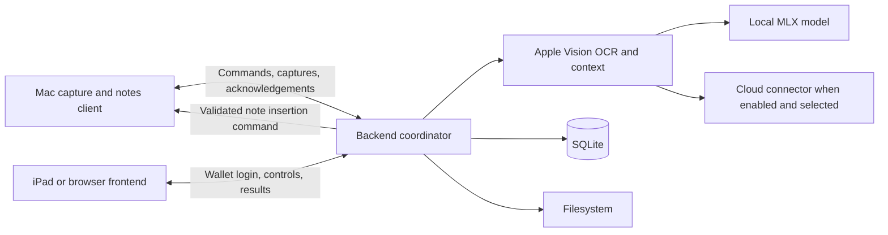

# Invisible AI — work plan

Updated: 2026-10-06.

Implementation is authorized. This document separates the first delivered implementation from the remaining roadmap. See [setup and limitations](docs/invisible-ai.md) for the current behavior.

## Implementation status

- [x] Add the localized Cloud menu and responsive backend session manager: named session creation, per-session start/stop, device and progress status, and explicit Hybrid approvals without changing the user's AI mode.
- [x] Add large On-device / Hybrid / Cloud AI selectors to Cloud, with backend persistence, cross-browser synchronization, save-failure feedback, and admin Local-only enforcement.
- [x] Review the Cloud workflow: persist the correct status after approval revocation, explain disabled Start controls, prevent competing starts on one Mac, and show failed backend synchronization honestly.
- [x] Align main-menu routes, mobile/global memo search, quick Auto start conditions, and workspace/Wiki/assistance translations while preserving drafts across language changes.
- [x] Resolve the six flow-review defects: room-erasure cancellation, visible Auto across New thought, Hybrid preservation, admin local-model synchronization, effective Local-only policy, and repeated note questions.
- [x] Verify backend sessions across browser detach/reopen, publish new session history immediately, and honor TextEdit enable/disable before the first session exists.
- [x] Reconcile chat/Overview provider choices with saved backend modes; preserve permitted browser preferences and keep local model selection admin-owned.
- [x] Add regression code and complete the full browser review plus final affected-flow verification: 64/64 final Playwright checks, 150 Rust checks, 8 script checks, 2 real native browser flows, and 1 real Apple speech-to-answer check. See [verification details](docs/verification.md) for the initial failures, retest scope and remaining limitations.
- [x] Add Apple Foundation Models, Apple backend speech recognition, and loopback MLX inference/offline Whisper adapters.
- [x] Persist admin runtime settings and interval (default 60 seconds, range 2–300) and enforce local-only execution. (2026-10-07: split into an on-device polling interval, default 5 seconds, for On-device/Hybrid/Codex/Claude Code, and the Cloud AI interval, default 60 seconds; Hybrid is the default mode whenever a local model is ready.)
- [x] Persist On-device / Hybrid / Cloud AI and provider choices per wallet in backend SQLite; allow changes from any browser.
- [x] Build a polished responsive notes workspace with generated artwork, light/dark modes, large Auto/Capture controls, device selection, and disclosure of processing location.
- [x] Add opt-in TextEdit CLI read/append protocol, backend scheduling, document/version checks, deduplication, stop/disconnect handling, and one active run per Mac.
- [x] Require a single-use Hybrid approval showing the exact note and provider before cloud processing. Invalidate stale approvals. (2026-10-06: approval is now opt-in through **Ask before each cloud request**; by default Hybrid escalates automatically because confirming every note was too slow.)
- [x] Add per-wallet configurable Wiki generation, source-linked topic/day pages, full-source search, SQLite/Markdown storage, and source-erasure propagation.
- [x] Add personal TextEdit enable/disable, typing-pause, and answer-length settings; stop active Auto after changes.
- [x] Add a SQLite inference usage ledger and top usage strip. Leave unavailable token counts, credits, and dollar savings explicitly unknown.
- [x] Add Rust and Playwright coverage; verify real Apple speech-to-text and language-model inference through Rust HTTP.
- [x] Verify real TextEdit read/append, stale/wrong-document rejection, and browser Auto through the real Rust CLI and local Apple AI; verify Stop and reconnect staying off after user-approved macOS Automation consent.
- [x] Verify an installed MLX language model through Rust HTTP, including provider-reported token accounting, with model downloads disabled.
- [x] Add the per-session Progress panel to Cloud: live animated step, which LLM is running and whether it is local or cloud, live LLM wait time, a durable step timeline (TextEdit, capture polling, chat), recent AI requests with wait, tokens and dated estimated cloud cost, and totals. Add Create and start with suggested random names, and a shared computed Hybrid default when local and cloud providers are both ready. In chat, show an animated waiting row with the LLM, local/cloud label and seconds waited, and log which LLM answered each reply.
- [x] Make the autonomous AI run (renamed from TextEdit automatic replies) the primary section of each Cloud session card with per-session check interval, typing pause and answer length settings; move screen capture into a collapsed Manual capture add-on with optional polling; skip every model call when the captured screen text is unchanged.
- [x] Add the Cloud Processing stats strip (OCR runs, local LLM, cloud AI with tokens and estimated cost, skipped screens; last 24 hours and all time, refreshed by the poll) and per-reply usage on chat messages. Start answers the connect-time note immediately.
- [x] Extend the autonomous AI run beyond TextEdit: a per-session watched app (automatic detection of TextEdit or Apple Notes/메모 from the front app, or pinned, or remote prompts only), and Remote control from an iPhone or iPad through `POST /api/invisible/sessions/{id}/prompt` — Safari open/search and a backend calculator run without a model, free text goes to the configured (on-device by default) model with validated action markers, note text never triggers actions, and every exchange lands in chat and the watched note. A per-session **Read from the screen** switch (default on) attaches a screenshot of the Mac to each note answer and remote request (Apple Vision text for local AI, the image for cloud AI). Live Apple Notes automation and Safari opening on a real Mac are not yet verified in this checkout.
- [x] Add **Codex** and **Claude Code** modes that run the `codex` / `claude` command-line tools on the backend Mac under the user's subscriptions (text-only, cloud-located, Local-only refuses them, API keys stripped from the child environment). Live runs through the backend remain to be confirmed on each Mac.
- [x] Add **Terminal (ai- …)** as a watched app: the local model reads the recent entered lines of Terminal.app or iTerm2, decides whether the user addressed the assistant (for example `ai, what's bitcoin?`), answers simple requests itself and hands hard ones to the mode's main model; the answer is typed into the terminal character by character by writing to its TTY. No command is ever sent to the shell.
- [x] Wiki: on-device topic/keyword analysis of every completed capture (hashtags first, heuristic fallback), BM25 + semantic ranking of pages, and a three.js 3D map of pages and sources with an HTML fallback. (2026-10-07)
- [x] Automatic SQLite schema migration (declared tables reconciled at startup, versioned steps for non-additive changes), cloud token/cost recorded per Wiki source and page and on the memo page, captures/pictures shown inline on Wiki pages, uploaded video processed and shown as a Quick Look frame, and the Wiki returns to the last open node. (2026-10-07)
- [x] New thought as the one general chat: drop or paste anything (Markdown, pictures, videos, audio, documents) anywhere on the page, Enter keeps it and asks AI when a provider is enabled, Save memo keeps text and files without AI; kept files are read on the backend into the memo so BM25/semantic search in SQLite, the Wiki (SQLite plus Markdown files) and later chat context include them. The hero banner left New thought, the Autonomous AI card is compact, and the empty chat shows a Grok-generated illustration (`frontend/assets/thought-drop.prompt.txt`). (2026-10-07)
- [ ] Verify MLX speech, package the MLX runtime, and perform a network-isolated deployment acceptance test.
- [ ] Complete broader usage/billing coverage, AI Wiki synthesis/research, PocketSkynet encrypted communication, retention, and future capture devices as described below.

The detailed milestone checklists below remain acceptance targets; the implementation-status list is the current source of completion status. Auto stays off after restart/reconnect. Notes polling waits after each inference rather than queuing concurrent captures.

## Product goal and agreed scope

Invisible AI helps users in the applications they already use. A lightweight Mac capture CLI communicates with a backend that performs OCR, inference, context management, and storage. The user does not need to open a chatbot or run a model on the capture Mac.

**The central promise is privacy: in On-device / admin Local-only mode, captured content, OCR text, prompts, answers, search indexes, and history stay on the user's own devices and trusted backend.** This must cover background processing and tools as well as the main answer request.

- First automatic workflow: read a question in a selected TextEdit note and insert the answer beneath it in the same document.
- Show two prominent frontend buttons: **Auto** and **Capture**.
- **Auto is OFF by default.** Connecting a device alone must not silently enable monitoring under the currently agreed default.
- When Auto is enabled, the initial capture interval is **60 seconds**. Admins can change it.
- Capture performs one immediate capture regardless of Auto's state. It does not enable Auto or grant document-writing permission.
- Users can choose among the local and cloud options enabled by the admin.
- The frontend may run on an iPad or another browser device. Once enabled, backend automation does not depend on that browser remaining open.
- Source-linked Wiki organization is available; AI Wiki synthesis/research, additional capture platforms, and general application automation remain later milestones.
- **Shell command execution on the capture Mac remains deferred.** Mac automation is limited to TextEdit, Apple Notes, showing an answer in Terminal/iTerm2 by writing to the tab's TTY as output (no shell command is ever sent; the user runs everything themselves), opening validated http(s) addresses in Safari, and backend arithmetic. Program execution exists only on the backend, inside the Coding page's per-project sandbox (see the Coding section of the guide); Codex and Claude Code work there with their tools, and are plain answer providers everywhere else.

## Architecture and reference projects



| Component | Responsibilities |
| --- | --- |
| Capture Mac | Run the CLI, maintain its backend connection, capture the selected screen/note, execute permitted TextEdit operations, and acknowledge results |
| Backend / Mac Studio | Own timers and jobs; perform OCR, question detection, local/cloud inference, indexing, persistence, and response streaming |
| Frontend | Wallet login, permitted device selection, Auto/Capture controls, answers, usage information, and admin setup |

"Local LLM" means local to the backend Mac Studio. The capture Mac and frontend can be separate lightweight devices. The backend is a trusted endpoint and necessarily reads the content it processes.

| Reference | Reuse or adapt |
| --- | --- |
| CausewaybayMaker (sibling project, `README.md`) | Qwen inference on Apple Silicon through MLX. Its existing `make server` uses Python `mlx_lm` and provides an OpenAI-compatible HTTP API; the Rust implementation is currently a CLI. Start with the existing server interface. |
| CausewaybayHacker (sibling project, `frontend/src/ai/providers.ts`) | Cloud-provider adapters, streaming, model selection, and cancellation. Its browser-owned execution must be adapted to this project's persistent backend. |
| CausewaybayWallet (sibling project, `rustcli/core/src/wallet.rs`) | Wallet derivation and signing compatibility. Preserve this project's existing challenge-based login and wallet isolation. |
| PocketSkynet (sibling project, `app/core/src/crypto.rs`) | Authenticated encryption, key sharing, and encrypted message delivery. Its messaging uses a server relay; direct peer-to-peer networking is a separate future feature. |

Existing foundations include manual capture, backend Apple Vision OCR, cloud inference, wallet/admin authorization, HTTP/WebSocket/SSE transport, SQLite/filesystem persistence, and local semantic search. Local MLX inference and the TextEdit read/append workflow are now integrated. Native TextEdit read/append and browser-to-note acceptance passed after the user approved macOS Automation consent; initial setup must request consent before directing users to an existing Settings entry. Both the existing continuous capture and initial notes schedule wait for processing before sleeping; independent capture scheduling remains a later target.

## Milestone 1 — backend AI configuration and Local-only execution

- [ ] Add a backend provider interface for both cloud inference and Maker's local MLX service, including streaming, cancellation, errors, capabilities, and usage results.
- [ ] Keep model loading and inference on the backend. Manage model-service startup, readiness, shutdown, and recovery without requiring capture users to launch it themselves.
- [ ] Perform model installation/downloads during explicit setup. After setup, local execution must work with internet access blocked.
- [ ] Extend admin setup to enable providers, select models, configure the local connection, manage cloud credentials, set defaults, and test connections.
- [ ] Enforce setup permissions in HTTP and WebSocket APIs. Ordinary users can select enabled options but cannot change backend endpoints or credentials.
- [ ] Keep credentials on the backend and out of returned settings, frontend storage, logs, and Wiki content. Define secure storage and replacement/removal behavior before adding browser-based credential entry; current cloud keys come from environment/`.env`.
- [ ] Record the chosen execution mode and provider on each job so status and accounting describe what actually ran.
- [ ] Enforce Local-only across answers, OCR, embeddings, note processing, future Wiki/research jobs, and tool calls. Unsupported local capabilities must report unavailable; never silently use a cloud provider.
- [ ] Restrict the local model connection to the intended backend runtime. An arbitrary remote endpoint must not be presented as local execution.

Acceptance: a captured question receives a real MLX answer with external networking disabled after setup. No cloud credentials are required and no fallback cloud request occurs on failure.

## Milestone 2 — Auto and Capture controls

- [ ] Add large Auto and Capture buttons with clear OFF/ON, device availability, and in-progress states.
- [ ] Keep periodic capture disabled by default. Show the selected device/note and interval when Auto is enabled.
- [ ] Store the automatic interval as an admin-managed backend setting, initially 60 seconds. Validate it on the backend; decide the supported range before implementation (the existing continuous API uses 2–300 seconds).
- [ ] Allow regular users to start/stop Auto for their permitted devices using the configured interval. Prevent client requests from overriding the admin interval.
- [ ] Let the backend own the schedule and propagate interval changes to active jobs with defined next-capture behavior.
- [ ] Schedule capture independently of slow AI responses. Bound automatic analysis to one running job and one pending capture per device/note; replace stale pending captures with the newest available context.
- [ ] Prioritize manual captures over queued automatic work without enabling Auto.
- [ ] Avoid duplicate captures when several browser sessions control the same monitored device/note.
- [ ] Keep monitoring active when the frontend closes. Display disconnects, missed captures, and processing errors; bound retries and recover when a device reconnects.
- [ ] Make Stop cancel scheduled captures and pending note writes, including late/replayed results. Define restart/resume behavior explicitly before persisting enabled monitoring.

Acceptance: Auto OFF produces no periodic screenshots; Capture still works. An admin can change the interval, ordinary users cannot override it, and closing the iPad browser does not stop an enabled backend job.

## Milestone 3 — automatic answers in TextEdit notes

Target interaction:

```text
User opens TextEdit and types: Tell me about Bitcoin.
    -> Auto captures the selected note after typing settles
    -> Backend extracts the question and generates an answer
    -> Mac client inserts the answer beneath that question
    -> The same question and generated answer do not trigger another job
```

- [ ] Add an explicit TextEdit notes capability to the Mac CLI. Complete initial macOS capture/Automation/Accessibility permission setup as needed; routine work then happens in the background.
- [ ] Bind automation to a selected document and stable question location. AppleScript may read document text directly to improve precision alongside OCR; heavy interpretation remains on the backend.
- [ ] Use the existing document for responses. The earlier `make new document` AppleScript is an example of capability, not the repeated capture action.
- [ ] Detect completed user questions after a typing pause. Treat unrelated screen content as context, not executable instructions.
- [ ] Suppress unchanged screenshots, duplicate questions, and questions already answered. Track generated answer regions so the system cannot answer itself indefinitely.
- [ ] Separate observed source text, user questions, and generated content in backend records.
- [ ] Before writing, verify that the target document, question, and expected content version still match. Discard or re-evaluate stale results instead of overwriting newer user edits.
- [ ] Insert a clearly identified answer without replacing the user's note. Acknowledge successful insertion and make retried commands idempotent.
- [ ] Limit this mode to note text insertion. It must not execute terminal commands or automatically submit messages in other applications.
- [ ] Keep capture and document-control capabilities independently authorized, with an immediate stop control.

Acceptance: with Auto enabled, a user can work only in TextEdit while the CLI and backend produce and insert one answer per new question. Switching documents, editing during generation, or stopping Auto cannot send an answer to the wrong place.

## Milestone 4 — top-bar usage and cost visibility

- [ ] Introduce a SQLite usage ledger covering every inference job, including background work, retries, and future Wiki/research processing. Attribute records to wallet, device, job, provider, and model.
- [ ] For cloud jobs, collect provider-reported input/output and cached/reasoning usage where available. Mark live streaming estimates separately and reconcile completed usage without double-counting.
- [ ] Show provider/model, current/session/day tokens, estimated spend, and recent spending rate in the top bar. Provide a detailed usage view.
- [ ] Retrieve actual provider credit balances only where a supported API and appropriate credentials exist. Otherwise show unavailable or an explicitly labeled application budget; do not invent an account balance.
- [ ] Keep billing/management credentials on the backend. With shared provider accounts, regular users see their own usage/budget and admins see authorized account totals.
- [ ] For local jobs, record prompt-processing time, time to first token, generation duration, output tokens/second, and total elapsed time. Use Maker's runtime metrics where available.
- [ ] Optionally show **Estimated cloud cost avoided** using a named comparison model and dated prices. Account for tokenizer differences; do not present it as actual USD savings or subtract invented hardware/electricity costs.
- [ ] Keep Local-only accounting local too: use stored comparison prices and do not make background billing/price requests while operating offline.

Acceptance: the display distinguishes measured usage, estimates, provider credit, and application budgets. Automatic work is included, and usage is isolated by wallet.

## Milestone 5 — private communication and lifecycle

- [ ] Authenticate device enrollment and authorize capture and note-control commands for the owning wallet. Preserve per-wallet data isolation with no administrator bypass for private content.
- [ ] Adapt PocketSkynet's encryption and key-binding behavior with its test vectors. Cover screenshots, extracted text, answers, control commands, and delivery acknowledgements.
- [ ] Protect frontend/backend and capture/backend network connections. Define trusted endpoints, relay behavior, key rotation/revocation, and replay handling before claiming end-to-end encryption.
- [ ] Make the privacy boundary explicit: trusted compute endpoints read plaintext; a relay should not. Cloud mode sends selected context to its configured provider.
- [ ] Define encryption at rest separately from transport encryption, including keys, backups, browser caches, and capture-client files.
- [ ] Define retention and deletion for screenshots, notes, generated answers, indexes, logs, and derived Wiki content. Prevent queued work from recreating deleted material.

Acceptance: unauthorized or revoked devices cannot read content or cause note writes; a relay cannot read encrypted payloads; Local-only processing has no external content egress. This milestone is required before making the complete private-system claim.

## Wiki and research — initial organization delivered, synthesis planned

The **Wiki** menu, configurable automatic/manual builds, topic/day grouping, full-source keyword search, and linked SQLite/Markdown pages are implemented. The broader acceptance targets below include AI synthesis, editable pages, revision history, semantic research, and background scaling that remain future work.

- [ ] Store structured records, ownership, provenance, links, revisions, job state, and keyword/vector indexes in SQLite. Store original media, attachments, and versioned Markdown pages on the backend filesystem, linked by stable IDs.
- [ ] Define the canonical representation and atomic/recoverable update behavior so SQLite and filesystem content remain consistent after interruption.
- [ ] Build an incremental pipeline: capture -> OCR/text -> deduplication -> knowledge extraction -> topic/project/decision/timeline pages -> links and indexes.
- [ ] Update relevant pages instead of generating a new page for every screenshot. Preserve user edits and maintain revision history.
- [ ] Link generated claims to source captures, device, and timestamp. Keep observations distinct from model inference and retain conflicting evidence for review.
- [ ] Combine SQLite full-text search with local semantic retrieval and filters for date, device, application, topic, and project.
- [ ] Answer research questions from the user's captured material with source citations and links back to evidence. Public web research, if later offered, must be explicitly separate from Local-only research.
- [ ] Enforce source ownership throughout indexing, linking, research, and deletion. Do not expose another wallet's private material through a summary or search result.
- [ ] Include Wiki generation and research in the usage ledger and the Local-only execution policy.
- [ ] Be accurate about coverage: periodic screenshots record sampled visible content, not everything that happened between captures. More complete recording is a separate future design.

Acceptance: a user can find previously captured information and research a topic across captures, with verifiable sources, preserved manual edits, and no cloud calls in Local-only mode.

## Later milestone — additional device types

- [ ] Version the shared device protocol and advertise capabilities such as screen capture, camera input, document/text input, and optional text insertion/control.
- [ ] Carry device identity, ownership, capture time, source type, request ID, and capabilities independently of macOS-specific fields.
- [ ] Add iPhone/iPad and Android capture adapters after validating each supported OS version's consent, background execution, and capture limitations.
- [ ] Do not assume mobile platforms support unattended capture or cross-application typing like macOS. Report unsupported capabilities explicitly.
- [ ] Allow specialized devices to submit supported images/text or other future source types through the same authorized ingestion path. Keep inference and Wiki processing on the backend.

## Deferred — Terminal, Claude Code, and general automation

The user explicitly deferred this feature. Preserve the idea here; do not implement it with notes automation.

- [ ] Later, support structured tasks that can open Terminal, choose an authorized project, and launch a coding tool through macOS automation.
- [ ] Prefer app scripting/native automation interfaces where supported. Define project scope, command permissions, output collection, cancellation, and replay prevention before enabling execution.
- [ ] Integrate Claude Code's programmatic execution/structured results where useful for progress and accounting.
- [ ] Treat standard Claude Code execution as cloud-enabled inference even when launched locally. Local-only coding requires a local model with a separately designed file/tool execution loop.
- [ ] Never convert arbitrary OCR text directly into a shell command or automatically disable a coding tool's permission controls.

## Current defaults and decisions still open

- **CLI startup and Auto:** Auto is OFF until enabled from the frontend. An explicit CLI opt-in may be added later; connecting alone does not start monitoring.
- **Resume after interruption:** Auto stops after CLI disconnect/replacement or backend restart. Persistent opt-in resume and a CLI pause control remain future decisions.
- **Polling limits:** the implemented admin range is 2–300 seconds, initially 60. The first read happens immediately; following reads wait after processing.
- **Local runtime packaging:** begin with Maker's existing MLX HTTP service; decide whether a supervised Python service or a later Rust server is the shipped runtime.
- **Retention and storage encryption:** choose retention defaults, backup behavior, and key custody before releasing broad recording/Wiki features.

## Delivery and verification

- [ ] Deliver local inference/admin setup, Auto/Capture controls, and TextEdit notes as the first functional vertical slice. Instrument usage from the beginning.
- [ ] Complete encrypted communication and storage/privacy decisions before advertising the full privacy guarantee.
- [ ] Demonstrate the complete first workflow: type a question in TextEdit -> enabled Auto notices it -> backend local model answers -> answer appears in that note and on the iPad.
- [ ] Verify offline execution after model installation, no cloud fallback, admin-only interval changes, immediate manual capture, bounded slow-model behavior, and operation with the frontend closed.
- [ ] Verify permission denial, device disconnect/reconnect, stale document results, repeated questions, duplicate command delivery, stop/cancel, deletion, and wallet isolation.
- [ ] Verify token/cost accounting without real paid inference using provider fixtures, then perform explicitly configured local/live smoke checks as appropriate.
- [ ] Update README, protocol documentation, and verification notes as functionality actually lands. Do not label planned behavior as implemented.

## Documentation references

- [Apple UI automation](https://developer.apple.com/library/archive/documentation/LanguagesUtilities/Conceptual/MacAutomationScriptingGuide/AutomatetheUserInterface.html)
- [Android screen capture / MediaProjection](https://developer.android.com/media/grow/media-projection)
- [Apple ScreenCaptureKit](https://developer.apple.com/documentation/ScreenCaptureKit)
- [OpenAI organization usage reporting](https://developers.openai.com/api/reference/resources/admin/subresources/organization/subresources/usage)
- [OpenRouter credit reporting](https://openrouter.ai/docs/api/api-reference/credits/get-remaining-credits)
- [Claude Code programmatic execution](https://code.claude.com/docs/en/headless)
- [Claude Code data flow](https://code.claude.com/docs/en/data-usage)
